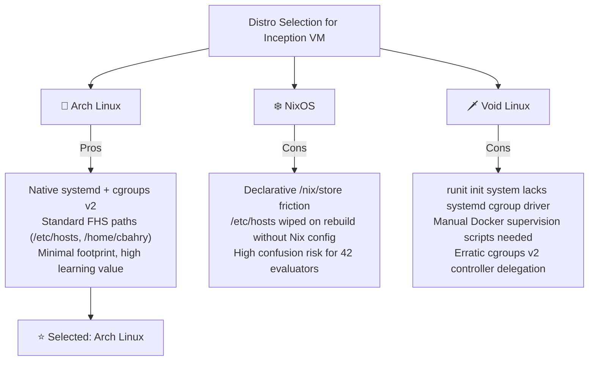

# 🖥️ Step -1: Virtual Machine Setup & Distro Codex

> [!abstract] Purpose
> Setting up a bare-metal hypervisor virtual machine to host our Docker infrastructure. The containers are bound to Debian Bullseye/Alpine, but the host VM is our playground.

---

## 🥊 The Distro Showdown: Arch vs. NixOS vs. Void



> [!tip] The Verdict
> **Arch Linux** provides the absolute ideal balance: maximum transparency and learning without the non-standard filesystem friction of NixOS or the cgroup delegation headaches of Void's runit.

---

## ⚙️ Hypervisor Configuration (VirtualBox / UTM / VMware)

- **vCPUs:** 2
- **RAM:** 2048 MB – 4096 MB
- **Disk:** 25 GB – 30 GB (Dynamic VDI or qcow2)
- **Network:** NAT with Port Forwarding

### 🌐 Port Forwarding Table
| Service | Host Port | Guest Port | Purpose |
|---|---|---|---|
| **SSH** | `2222` | `22` | Headless access & VSCode Remote SSH |
| **HTTPS** | `443` | `443` | Web entrypoint to NGINX |

> [!danger] Critical NAT Port Forwarding Rule
> In VirtualBox Port Forwarding, **LEAVE GUEST IP BLANK**. Putting `127.0.0.1` in Guest IP causes VirtualBox to drop the packet, resulting in `kex_exchange_identification: read: Connection reset by peer`.

---

## 🛠️ Troubleshooting: SSH Connection Reset by Peer

If running `ssh -p 2222 cbahry@127.0.0.1` triggers:
```text
kex_exchange_identification: read: Connection reset by peer
```

Run this 3-step fix inside the VM:
```bash
# 1. Generate SSH host keys (mandatory on Arch)
sudo ssh-keygen -A

# 2. Enable and start sshd service
sudo systemctl enable --now sshd

# 3. Verify sshd is listening on all interfaces (0.0.0.0:22)
sudo ss -tlpn | grep 22
```

> [!example] Headless SSH Command
> ```bash
> ssh -p 2222 cbahry@127.0.0.1
> ```

---

## 🚀 Post-Install Provisioning Runbook

```bash
# 1. Update and install core toolchain
sudo pacman -Syu --noconfirm
sudo pacman -S --noconfirm docker docker-compose git make curl openssl openssh net-tools tree vim

# 2. Enable Docker daemon via systemd
sudo systemctl enable --now docker

# 3. Add user to docker group (avoid sudo docker)
sudo usermod -aG docker cbahry
newgrp docker

# 4. Prepare host volume paths
mkdir -p /home/cbahry/data/mariadb
mkdir -p /home/cbahry/data/wordpress

# 5. Point domain name to localhost
echo "127.0.0.1 cbahry.42.fr" | sudo tee -a /etc/hosts
```

---

## ⚡ Active Recall & Defense Drill

> [!question] Q1: Why does Docker run natively with zero friction on Arch compared to Void?
> <details>
> <summary>Click to reveal answer</summary>
> Docker's default cgroup driver is engineered for <code>systemd</code>. Arch uses systemd natively, managing cgroups v2 hierarchies, unit slicing, and socket activation automatically. Void uses <code>runit</code>, which does not manage cgroups v2 natively and requires manual controller mounting and delegation scripts.
> </details>

> [!question] Q2: How does glibc resolve cbahry.42.fr before querying any internet DNS server?
> <details>
> <summary>Click to reveal answer</summary>
> via <code>/etc/nsswitch.conf</code>, which defines the lookup order as <code>hosts: files dns</code>. The <code>files</code> entry tells the resolver to inspect <code>/etc/hosts</code> first. Because <code>127.0.0.1 cbahry.42.fr</code> is present, it resolves locally with 0 network latency.
> </details>

---
*Back to: [[00 - Inception Master MOC]]*
