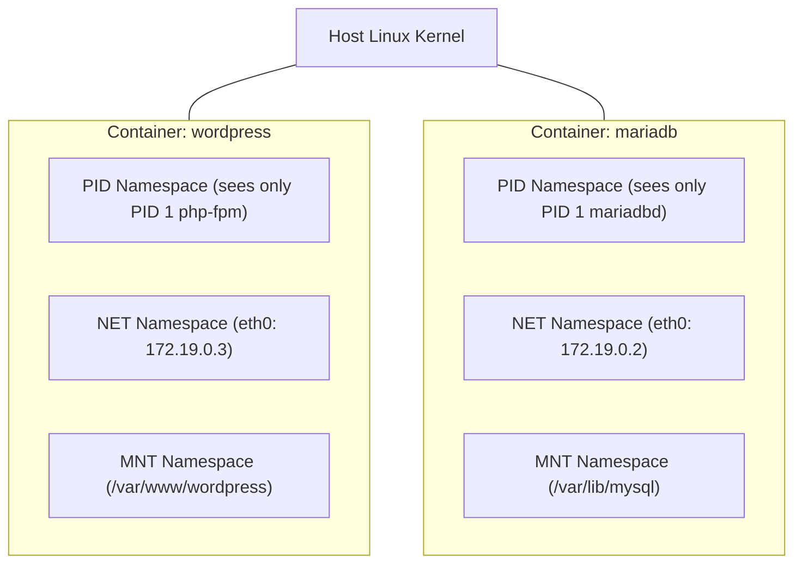

# 🧬 Linux Namespaces and Control Groups (cgroups)

> [!abstract] High-Level Mental Anchor
> A Docker container is **not** an emulated machine. It is a standard Linux process wearing **two sets of glasses**:
> 1. **Namespaces** decide **what the process can SEE** (optical illusion of having its own private OS).
> 2. **cgroups** decide **what the process can USE** (a strict budget on CPU, RAM, and IO).

---

## 🔍 The 7 Kernel Namespaces

When Docker launches a container, it invokes the Linux `clone()` or `unshare()` system call with specific namespace flags:

| Namespace | Syscall Flag | What It Isolates |
|---|---|---|
| **PID** | `CLONE_NEWPID` | Process IDs. The container process believes it is **PID 1**, unable to see host processes. |
| **NET** | `CLONE_NEWNET` | Network interfaces (`eth0`, `lo`), routing tables, IP filter rules, and port bindings. |
| **MNT** | `CLONE_NEWNS` | Mount table. Mounting or unmounting filesystems inside does not affect the host. |
| **IPC** | `CLONE_NEWIPC` | Inter-Process Communication (POSIX message queues, System V shared memory). |
| **UTS** | `CLONE_NEWUTS` | Hostname and NIS domain name (`gethostname()` / `sethostname()`). |
| **USER** | `CLONE_NEWUSER` | User and Group IDs. Root inside container can be mapped to an unprivileged user on the host. |
| **CGROUP** | `CLONE_NEWCGROUP` | Isolates the cgroup root directory visible to the process. |

---

## ⚖️ Control Groups (cgroups v2)

While namespaces create process isolation, **cgroups** prevent a rogue container from exhausting host resources:
- `memory.max`: Hard limit on physical RAM before the Linux kernel OOM (Out Of Memory) killer strikes.
- `cpu.weight` / `cpu.max`: Restricts CPU cycles and core allocation.
- `pids.max`: Hard ceiling on processes, preventing fork-bomb attacks.
- `io.weight`: Disk read/write throughput budgeting.

---

## ⚡ Active Recall & Defense Drill

> [!question] Q: Does a Docker container run its own kernel?
> 

> 
Click to reveal answer

> No. Containers share the host Linux kernel directly. Isolation is achieved solely through kernel namespaces (restricting visibility) and cgroups (restricting resource consumption).
> 

> [!question] Q: How can you inspect the namespaces of a running container on the host?
> 

> 
Click to reveal answer

> Find the container's host PID using <code>docker inspect -f '{{.State.Pid}}' &lt;container_id&gt;</code>, then list its namespace symlinks using <code>ls -l /proc/&lt;PID&gt;/ns/</code>.
> 

---
*Back to: [[00 - Inception Master MOC]]*
