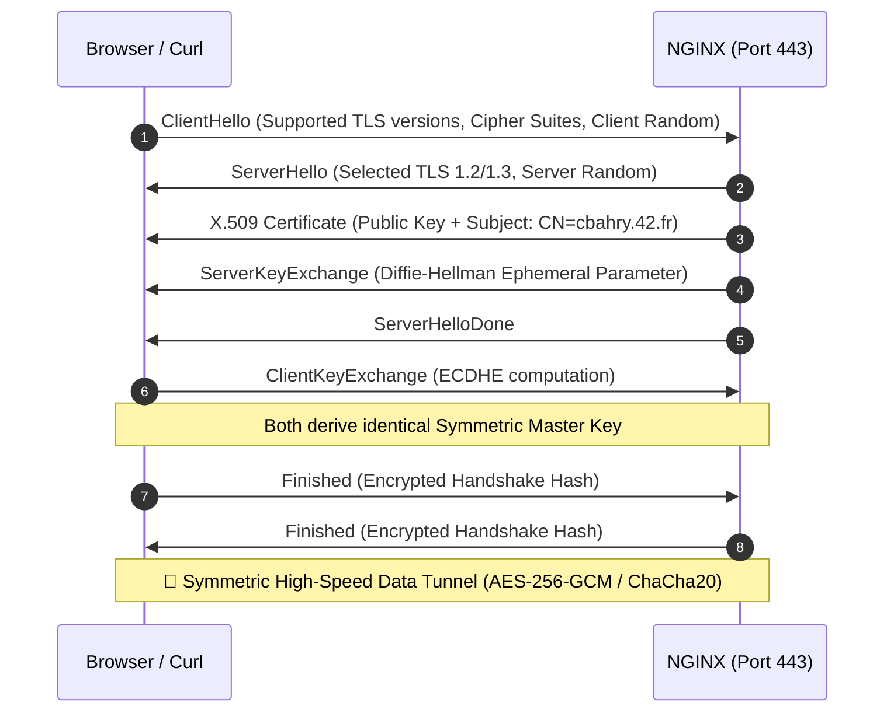

# 🔒 Transport Layer Security (TLS 1.2 & TLS 1.3)

> [!abstract] Subject Mandatory Requirement
> *"A Docker container that contains NGINX with TLSv1.2 or TLSv1.3 only... Your NGINX container must be the only entrypoint into your infrastructure via the port 443 only, using the TLSv1.2 or TLSv1.3 protocol."*

---

## 🔬 Cryptographic Foundations

TLS solves three critical security problems on an untrusted network:
1. **Confidentiality (Encryption):** Prevents eavesdroppers from reading data in transit.
2. **Integrity (Tamper-proofing):** Ensures data cannot be altered or replayed (via AEAD ciphers).
3. **Authentication (Identity):** Proves to the client that they are speaking to the genuine `cbahry.42.fr` server via an X.509 certificate.

---

## 🤝 The TLS Handshake Mechanics



---

## 📜 Generating the Self-Signed Certificate via OpenSSL

```bash
openssl req -x509 -nodes -days 365 -newkey rsa:2048 \
    -keyout /etc/ssl/private/nginx-selfsigned.key \
    -out /etc/ssl/certs/nginx-selfsigned.crt \
    -subj "/C=FR/ST=IDF/L=Paris/O=42/OU=42Paris/CN=cbahry.42.fr"
```

### Breakdown of Flags:
- `req`: PKCS#10 X.509 certificate management tool.
- `-x509`: Instructs OpenSSL to output a self-signed certificate directly, rather than generating an intermediate Certificate Signing Request (CSR).
- `-nodes`: "No DES" — the generated private key is stored unencrypted without a passphrase prompt, allowing NGINX to boot automatically without manual human intervention.
- `-newkey rsa:2048`: Generates a secure 2048-bit RSA asymmetric key pair.
- `-subj`: Provides the distinguished identity directly, ensuring `CN=cbahry.42.fr` matches our target domain.

---

## ⚡ Active Recall & Defense Drill

> [!question] Q: Why are TLS 1.0 and TLS 1.1 prohibited by the subject?
> <details>
> <summary>Click to reveal answer</summary>
> TLS 1.0 and 1.1 rely on obsolete cryptographic hashes (MD5, SHA-1) and CBC-mode ciphers vulnerable to structural attacks such as BEAST, POODLE, and Lucky 13. TLS 1.2 and 1.3 mandate secure AEAD (Authenticated Encryption with Associated Data) ciphers like AES-GCM and ChaCha20-Poly1305.
> </details>

> [!question] Q: How do you verify NGINX accepts TLS 1.2 / 1.3 and rejects older versions?
> <details>
> <summary>Click to reveal answer</summary>
> Run <code>curl -vk --tlsv1.2 https://cbahry.42.fr</code> (succeeds), <code>curl -vk --tlsv1.3 https://cbahry.42.fr</code> (succeeds), and <code>curl -vk --tlsv1.1 https://cbahry.42.fr</code> (fails with handshake error).
> </details>

---
*Back to: [[00 - Inception Master MOC]]*
