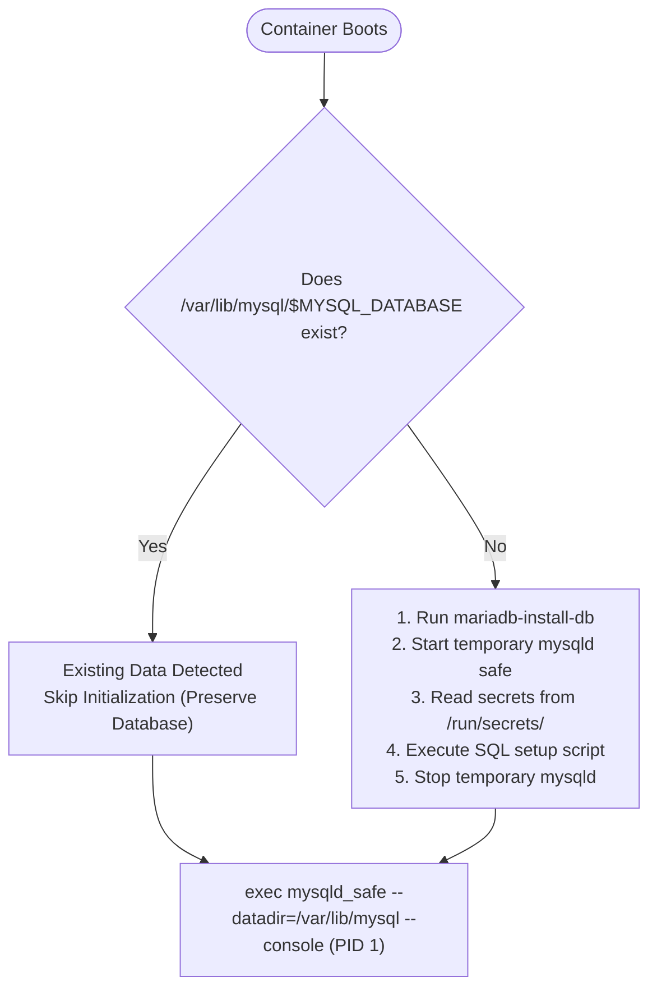

# 🐬 MariaDB Database Service

> [!abstract] Architectural Profile
> - **Container Name:** `mariadb`
> - **Base Image:** `debian:bullseye`
> - **Internal Port:** `3306` (isolated inside bridge network, never exposed to host)
> - **Storage Mount:** `mariadb_data` -> `/var/lib/mysql` -> `/home/cbahry/data/mariadb`
> - **Entrypoint:** `/usr/local/bin/mariadb_init.sh`

---

## 🛠️ Critical Configuration Steps

### 1. Network Binding (`50-server.cnf`)
In stock Debian Bullseye, MariaDB configures:
```ini
bind-address = 127.0.0.1
```
This restricts connections to the container's internal loopback interface. We must override this to allow connections across the Docker bridge network:
```ini
[mysqld]
bind-address = 0.0.0.0
port         = 3306
user         = mysql
datadir      = /var/lib/mysql
```

### 2. Idempotent Initialization Flow
When the container starts, the entrypoint script executes the following logic:



### 3. SQL Bootstrap Script
```sql
CREATE DATABASE IF NOT EXISTS `${MYSQL_DATABASE}`;
CREATE USER IF NOT EXISTS '${MYSQL_USER}'@'%' IDENTIFIED BY '${MYSQL_PASSWORD}';
GRANT ALL PRIVILEGES ON `${MYSQL_DATABASE}`.* TO '${MYSQL_USER}'@'%';
ALTER USER 'root'@'localhost' IDENTIFIED BY '${MYSQL_ROOT_PASSWORD}';
FLUSH PRIVILEGES;
```

---

## ⚡ Active Recall & Defense Drill

> [!question] Q: Why do we use '% ' in '${MYSQL_USER}'@'%'?
> <details>
> <summary>Click to reveal answer</summary>
> In MySQL/MariaDB, user accounts are defined as <code>'username'@'hostname'</code>. The <code>%</code> wildcard allows the WordPress container to connect from any internal IP address assigned dynamically by Docker on the bridge network.
> </details>

---
*Back to: [[00 - Inception Master MOC]]*
